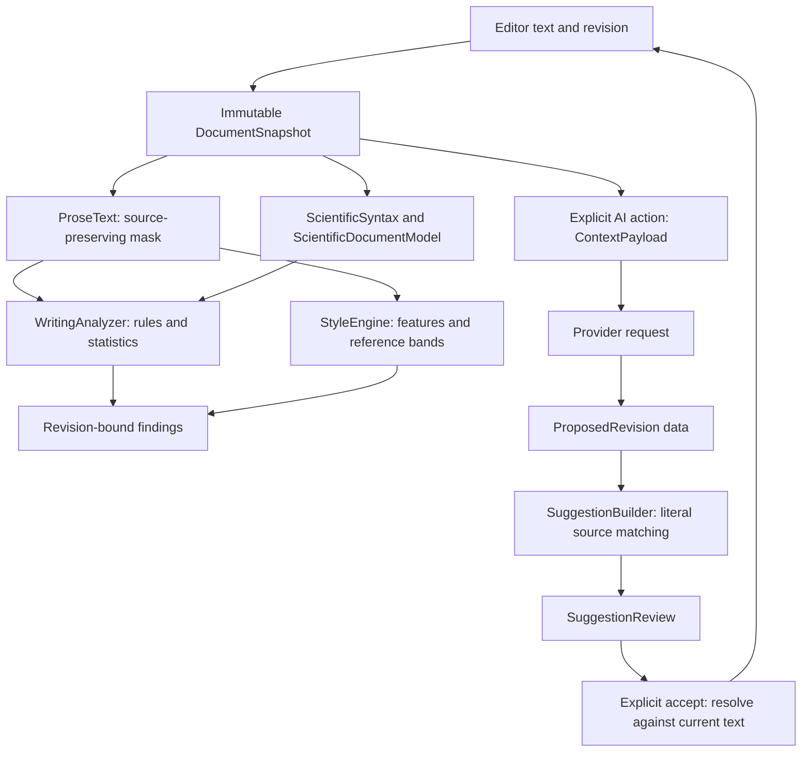

# Technical documentation

These pages describe the implementation in this repository. Source links name the
contracts to inspect when behavior changes; thresholds and prompt copies describe
current code, not guarantees about model output.

| Page | What it explains |
|---|---|
| [Computation pipeline](computation.md) | Source masking, tokenization, statistics, local writing rules, spelling, and revision handling |
| [Statistical style analysis](style-analysis.md) | Every feature, reference bands, signal levels, and specificity heuristics |
| [Scientific analysis](scientific-analysis.md) | LaTeX scanning, symbols, quantities, references, claims, graph relationships, and diagnostics |
| [AI prompts and context](ai-prompts.md) | Exact editorial and task prompts, issue-action prompts, scope selection, and data access |
| [AI execution and review](ai-runtime.md) | Provider adapters, process isolation, response parsing, anchoring, acceptance, cancellation, and limitations |
| [Tests and evaluation](testing-and-evaluation.md) | Offline contracts, opt-in live tests, corpus generation, calibration, and what each harness proves |

## Data flow

[TersoCore](../Sources/TersoCore/Model.swift) supplies UTF-16 spans, snapshots,
issues, and annotations. `TersoAnalysis` and `TersoStyle` compute findings locally.
`TersoAI` depends on Core, but has no dependency on `TersoDocument` or the app's
editor. [SuggestionReview](../Sources/TersoDocument/Review.swift) owns the gate
from AI suggestion data to a text mutation. The dependency graph is declared in
[Package.swift](../Package.swift).

A [WorkspaceModel](../Sources/TersoApp/WorkspaceModel.swift) belongs to one document
session. Analysis tasks, AI tasks, revisions, and review state stay with that
session across native tab moves. Preferences are shared. Analysis and AI operate
on source text, not rendered Markdown HTML or a compiled LaTeX PDF.
